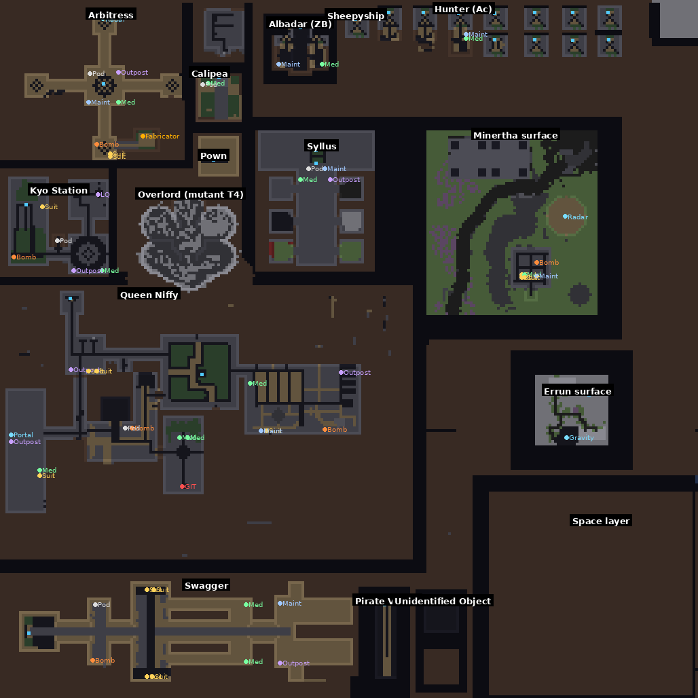

# 01 原圖分析：Metastasis 1.8.2

> 對象：`Metastasis 1.8.2.w3x`（Warcraft III 自訂地圖，作者 FelFox，協力 Clan Sirs）
> 中文圈俗稱「死亡空間」，台灣社群站：metastasis.gameclub.tw（不允許爬蟲讀取）、介紹帖：ipve.com/bbs/viewthread.php?tid=607883
> 本文件是重製（致敬版）的研究基礎；規則細節見 `02-core-rules.md`，世界／載具／事件見 `03-world-events.md`。

## 1. 結論摘要

- 這是一款 **2–12 人的隱藏身分（social deduction）＋即時戰鬥** 遊戲：人類船員裡藏著異形（Alien）與變種人（Mutant），後期還會出現仿生人（Android）。人類要靠推理、驗血（GIT）與合作找出並消滅異類；異類要靠偽裝、感染、進化把所有人殺光。
- 世界分兩層：**太空站內部**（玩家步行、戰鬥、買裝備）與**太空**（太空站、探索艇、戰艦在宇宙中移動、對接、互打）。太空站可被擊毀，**站內所有人一起死**。
- 內容量非常大：317 個自訂單位、82 個道具、334 個技能、約 2,046 個 JASS 函式。異形有 3 條 T2、9 種 T3 型態；變種人有 2 條路線、4 種 T2、7–8 種 T3（其中 Overlord 會變成一座可登上的太空站）。
- 原圖腳本已被混淆（optimizer），且 **trigger 編輯器資料已移除**，無法用 World Editor 直接打開修改；只能讀混淆後的 JASS。
- ⚠️ **這份檔案被植入了作弊後門**（見 §6），不是乾淨的原版。

## 2. 檔案結構

| 項目 | 內容 |
|---|---|
| 容器 | MPQ（標頭在 offset 512，sector shift 12，hash 表 512 項、block 表 292 項）|
| 腳本 | `scripts\war3map.j`，859,787 bytes，24,035 行，2,046 個 function，2,793 個字串常值 |
| 字串檔 | `war3map.wts`，141 筆（職業背景故事、指南、事件訊息），**英文原版**（不是 ipve 帖說的繁中版）|
| 物件資料 | w3u 單位 317、w3t 道具 82、w3a 技能 334（+8 改原生）、w3h buff 63、w3q 升級 13、w3d doodad 67、w3b 可破壞物 13 |
| 地形 | 257×257 tile corners（約 32,768×32,768 world units），tileset `J`，14 種地表、3 種懸崖 |
| 已移除 | `.wtg` / `.wct`（trigger 原始資料）、`war3mapUnits.doo`（預放單位改由腳本 CreateUnit 建立）、`(listfile)` 被加密亂碼 |

重新解出所有資料：`python3 -I tools/extract_all.py`（輸出到 `docs/research/_raw/`，該目錄不進版控）。

## 3. 地圖配置

標註說明：白字是地點（依預放單位推斷，見 `extracted/placements.json` 的 `location_guess`）；GIT＝驗血檢測儀、Med＝醫療販賣機、Suit＝防護服販賣機、Bomb＝熱融炸彈工廠、Maint＝維修站、Outpost＝前哨補給、Pod＝逃生艙裝置、Fabricator＝仿生人鑄造台、藍色小方塊＝控制台。無標註版：`img/terrain-layout.png`。

- 左上、左中、下方：各太空站的**內部**（每個站是一塊獨立的室內區域，透過登艦／傳送進出）。
- 右上綠地：行星 Minertha 的地表（有空置軍事基地）。
- 右下大方框：**太空層**（Rect(6560,-16384,16384,-6560)），所有太空站、行星、太陽、探索艇與戰艦在這裡以縮小比例移動；室內位置與太空位置沒有幾何關係，靠對照表連結。
- 上方一排小格：Syllus 的標本隔間（Cell 1–6）等小型內部空間。

各站內部的精確座標、預放單位與販賣機位置見 `03-world-events.md` 與 `extracted/placements.json`。

## 4. 系統清單（重製時都要覆蓋）

| 系統 | 摘要 | 參考 |
|---|---|---|
| 身分分配 | 0 秒分配。1–4 人：異形或變種人擇一；5–6 人：異形＋變種人；7–12 人：再加仿生人（開局即指定，偽裝成某職業）。介紹帖的 1–4／5–9／10–12 與程式不符 | 02 §1 |
| 人類職業 | 12 張卡抽 10 種：研究員 ×2（Dr.，隨機 PhD 被動）、保全 ×2（Private，隨機戰鬥裝）、醫護兵（Medic，治療術＋開局帶基因檢測器）、艦長（ID 卡鎖戰艦門）、清潔工（翻箱＋清潔間 ID 卡）、執行長（CEO，機器管家）、政委（處決手槍）、工程師（服務裝＋扳手＋駭門）、下士（+15% 攻擊、強化護腿）、王牌飛行員（Ace，專屬戰機）| 02 §2 |
| 防護服（Suit）| 18 種：Tesla、Rocket、Cryo、Plasma、Flamethrower、Photon、Service、Dark Matter、Illusion、Radiation、Operative、Scientist Coat、Guard、Acidic、Machinegun、Force、Magnetic、Pulse。穿上會變成對應的戰鬥單位與技能組 | extracted/items.md |
| 異形 | 人形／異形形態切換（異形形態下看不出是誰）；感染→殺死→轉成 spawn；最多 3 顆蛋產 EP（蛋被毀會受傷並暈眩而曝光）| 02 §3 |
| 變種人 | 進化前與人類無異；進化期間無敵但會保留 HP 百分比；完美路線（戰鬥）與感染路線（spawn）| 02 §4 |
| 仿生人 | 人類方；友傷分數 > 2.7 直接被殺；死亡掉記憶卡，帶到 Arbitress 鑄造台可復活，帶去的人拿到遙控器（異類拿到可把它轉陣營）；2000 EP 升級戰鬥底盤 | 02 §5 |
| EP／進化 | 門檻：異形 660、1370；變種人 300（字串寫 340，程式為 300）、900、1800；仿生人 2000；進化 60 秒（異形結繭 6000 HP，繭死＝異形死；變種人肉團無敵可移動）。每秒：仿生人 1.5；異形 0.4+0.28×spawn+0.12×蛋；變種人 0.4+0.28×spawn。變種人吃失敗實驗體 +25、吃屍體 +140、造成傷害的一定比例（完美路線單一玩家上限 200、感染路線 50）| wts #2423 |
| GIT 驗血 | Genetic Testing Device（420 秒後上架，醫護兵開局自帶）抽 3 人 DNA → 變成 GIT Resolver 部署取報告；依**身分旗標**判定（已寄生未死的人測起來乾淨），有仿生人則顯示錯誤；Queen Niffy 的檢測儀（HP 6000）被毀後無法出結果 | 02 §7 |
| 經濟 | 道具物件資料售價皆 0；靠販賣機庫存上限／補貨時間控制；另有週期性 +1 gold 與事件 +8000 credits、Cash ID 掉落 | 03 §5 |
| 太空／載具 | 站在控制台上駕駛太空站或探索艇；Dock 對接、Board 強行登艦、從白色拱門進出；站可被擊毀、站內全滅 | 03 §2–4 |
| 隨機事件 | 蟲洞物體、外星護盾海盜船、蛞蝓繁殖季、政府興奮劑發放、病毒重開機、Kyo 砲失控、軌道穩定器失效、末日（USI 艦隊／黑洞）等 | 03 §6 |
| 死亡系統 | 預設觀戰模式（死者只能和死者聊天）或即死踢出（投票切換）；剛死 4 秒內仍可「遺言」；可投票踢人 | 02 §10 |
| 聊天 | 全體、觀察者、自建群組（`-creategroup`、`;group 訊息`）、`-rename`、`-names`、`-status` | 02 §10 |

勝利條件（程式 `g6`，見 02 §11）：
- 人類：異形與變種人主腦皆死（或本局沒有），且沒有存活的 spawn；仿生人算人類方。
- 異形／變種人：另一方主腦已死或不存在，且所有存活玩家都屬於自己陣營（主腦死了 spawn 仍可替陣營取勝）。

## 5. 介紹帖補充的玩家觀點

- 人類前期最強但互不信任，中期開始結盟；後期異類變強，人類必須配合。
- 開局建議購買：防護服 → 追蹤器 → 興奮劑 →（有餘力）熱融炸彈。
- 異類常見戰術：炸掉驗血機（約 1 顆熱融炸彈＋數顆手榴彈）。
- 太空中沒有名字的飛船多半是異形在開。

## 6. ⚠️ 植入的作弊後門（不是原作內容）

這份 `.w3x` 被外部工具植入一整套作弊碼，與原作無關，重製時**不要**照抄。

| 項目 | 內容 | JASS 位置 |
|---|---|---|
| 指定帳號自動開作弊 | 玩家名 `JJ2197`、`FatherSpace` 進遊戲即加入作弊名單 | `StringRaw2`，約第 1183–1200 行 |
| 暗號開作弊 | 任何玩家在聊天輸入 `-PICCOLO`（後接兩個空白）即開啟 | `CheatUse`，約第 2171 行；全域 `Activator` |
| 指令 | `-hear`（看到所有人聊天）、`-mh`（全圖）、`-kill`、`-gold`、`-spawn`、`-invul`、`-copy`、`-owner`、`-kick`、`-cheaton/-cheatoff`、方向鍵綁定指令等數十個 | `Cheatz`／`DirectCheat`，約第 1716–2170 行 |
| 註冊 | 地圖初始化時對 12 位玩家註冊 `-` 開頭的聊天事件 | 約第 21385–21396 行 |

在隱藏身分遊戲裡，`-hear` 與 `-mh` 等於直接看穿所有人。若要拿原圖和朋友玩，請找乾淨版本或先移除這段。

## 7. 授權與致敬原則

- **可以重做**：遊戲機制、規則、系統架構、平衡數值的設計思路（機制不受著作權保護）。
- **不能照搬**：原作文字（職業故事、指南、tooltip）、Blizzard 與社群作者的模型／貼圖／圖示（credits 見 wts #1960–1962、#2012）、原圖載入畫面。
- **作法**：結構與玩法高度致敬，名稱、文字、美術全部原創；遊戲內 credits 註明「Inspired by *Metastasis* by FelFox & Clan Sirs」。
- 「Dead Space／死亡空間」是 EA 的遊戲商標；目錄名稱可沿用，遊戲對外標題用自己的名字（見 GDD）。
